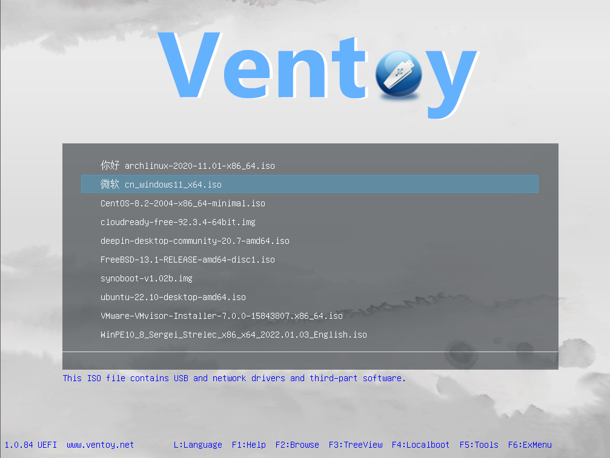

**3. Requisitos do Software.**

**3.1 Requisitos Funcionais**

* O sistema deve permitir que o usuário instale vários arquivos de imagem para o SO em um disco USB.

* O sistema deve permitir que o usuário instale o Ventoy em diversos drivers USB.
Link: https://www.ventoy.net/en/index.html?utm_source=chatgpt.com
* O sistema deve permitir que seja possível realizar instalação automática de distribuições Ubuntu Server na versão 20.x ou superiores por meio de arquivos de configuração baseados em cloud-init.
Link da issue: https://github.com/ventoy/Ventoy/issues/1351 
* O sistema deve permitir que o usuário escolha entre usar o estilo GPT ou MBR para partição.
Link: https://www.ventoy.net/en/index.html
* Na versão 1.0.11 do Ventoy foi adicionada a funcionalidade de persistência para distribuições como Ubuntu, MX Linux, Linux Mint e Elementary. A funcionalidade permite que alterações feitas durante o modo Live sejam armazenadas em um arquivo de persistência e recuperadas em futuras atualizações. 
Link das notas: https://www.ventoy.net/en/plugin_persistence.html

**3.2 Requisitos Não Funcionais**

* O sistema deve garantir compatibilidade em computadores com o firmware UEFI com Secure Boot Ativado, sem exigir a desativação manual da proteção na BIOS/UEFI da máquina cliente.
Link: https://github.com/ventoy/Ventoy/blob/master/SecureBoot.md
* O sistema deve estruturar e alinhar as estruturas de partições de USB em blocos de 4KB por padrão, para garantir otimização na instalação dos dispositivos. 
Link:https://github.com/ventoy/Ventoy/releases/tag/v1.0.36
* O sistema deve possuir um tutorial de como instalar e usar o Ventoy para usuários novos, leigos, etc.
Link: https://www.ventoy.net/en/doc_start.html
* A interface gráfica do Ventoy deve ser compatível com os sistemas operacionais e ambientes gráficos Linux suportados pelo projeto, permitindo sua execução adequada.
Link: https://github.com/ventoy/Ventoy/issues/3406

**3.3 Histórias de Usuário**

**Como técnico de suporte, eu gostaria de selecionar uma imagem ISO (Debian ou Windows) na lista exibida na interface de boot do Ventoy, para que eu possa carregar o respectivo instalador e realizar a instalação ou manutenção offline em qualquer computador.**

**Cenário 1**: **Dado** que o técnico de suporte possui um pen drive com armazenamento suficiente para ter a versão mais recente do Ventoy e as duas ISOs com suas respectivas versões mais recentes.
**Quando** o técnico conectar o pen drive em um computador e inicializar via dispositivo USB e selecionar a ISO do Debian.
**Então** o sistema deve carregar o ambiente de instalação do Debian, permitindo prosseguir com a instalação no disco da máquina. 

**Cenário 2**: **Dado** que o técnico de suporte possui um pen drive com armazenamento suficiente para ter a versão mais recente do Ventoy e as duas ISOs com suas respectivas versões mais recentes.
**Quando** o técnico conectar o pen drive em um computador e inicializar via dispositivo USB e selecionar a ISO do Windows.
**Então** o sistema deve carregar o ambiente de instalação do Windows, permitindo prosseguir com a instalação no disco da máquina. 

**Como estudante de T.I, eu gostaria de alternar entre o estilo de partição de MBR para GPT para avaliar a diferença entre eles na prática.**

**Cenário 1**: **Dado** que o software Ventoy está configurado com o estilo GPT.
**Quando** acessar as “Opções” e depois em “Estilo da Partição” e selecionar o estilo MBR.
**Então** deve ser exibido no “Ventoy no Pacote” a opção escolhida MBR no lugar de GPT para a próxima instalação.

**Cenário 1**: **Dado** que o software Ventoy está configurado com o estilo MBR.
**Quando** acessar as “Opções” e depois em “Estilo da Partição” e selecionar o estilo GPT.
**Então** deve ser exibido no “Ventoy no Pacote” a opção escolhida GPT no lugar de MBR para a próxima instalação.

**Como usuário comum do Ventoy, eu gostaria de alterar o idioma para português brasileiro.**

**Cenário 1**: **Dado** que o sistema esteja configurado na linguagem padrão em inglês.
**Quando** clicar no botão “Language” e selecionar o idioma “Portuguese Brazilian (Português Brasileiro)”.
**Então** deve ser alterado todas as opções que antes estavam no idioma padrão para português brasileiro.

**Cenário 2**: **Dado** que o sistema esteja configurado no idioma português brasileiro.
**Quando** o usuário fechar o software e abrir novamente.
**Então** a alteração de idioma deve ser mantida conforme estava.

**Como usuário, gostaria de poder atualizar a versão do Ventoy instalada no meu pen drive pelo software.**

**Cenário 1**: **Dado** que o Pen Drive já esteja com o Ventoy instalado e com uma versão mais antiga e conectado no computador.
**Quando** clicar na opção “Atualizar”, deve exibir uma mensagem pedindo a confirmação da ação informando que a atualização é segura e que os arquivos ISOs não serão alterados e mostrar uma caixa de carregamento. Ao clicar na opção “Sim”.
**Então** o Pen Drive terá a versão mais recente do Ventoy.

**Cenário 2**: **Dado** que o Pen Drive esteja com uma versão antiga do Ventoy instalada e conectado no computador.
**Quando** clicar na opção de “Atualizar”, será exibida uma mensagem pedindo a confirmação da atualização, informando que a atualização é segura e que os arquivos ISOs não serão alterados. Ao clicar na opção “Não”.
**Então** o software retorna à tela inicial sem alterar o dispositivo.
