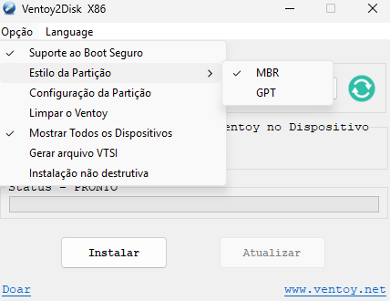

# 5. Evolução proposta

### Balões de Ajuda Explicativos (Tooltips / Botão ?) nas Opções da Tela Inicial.

  **Problema**: A interface inicial do Ventoy exibe termos técnicos como MBR, GPT, Secure Boot, Partition Configuration sem nenhuma descrição visual ou aviso explicativo, levando usuários iniciantes ou estudantes a escolherem configurações incompatíveis com seus computadores ou a cometerem erros durante a criação do pen drive.
  
  **Usuário afetado**: Usuários comuns, iniciantes e estudantes de T.I. que estão criando seus primeiros pendrives bootáveis e não dominam conceitos avançados de particionamento ou firmware.

  **Evidências**:
   * O usuário relata que a interface é péssima, especialmente em Linux, e usuários novos podem ter dificuldades em utilizar o software.
     Link: https://github.com/ventoy/Ventoy/discussions/1807

  
  
  **Solução proposta**: Adicionar ícones de interrogação (?) ou balões explicativos (tooltips) ao lado das opções principais da tela inicial e do menu Opção (Instalar, Atualizar, MBR, GPT, Secure Boot, Configuração de partição), exibindo em linguagem simples o que cada opção faz e quando utilizá-la. 

  **Benefício esperado**: Redução de erros de configuração por usuários leigos, diminuição da necessidade de consultar tutoriais externos antes de usar o programa e maior segurança antes de executar operações de formatação.
  
  **Prioridade**: Alta (baixo esforço de implementação e impacto direto na usabilidade para novos usuários).
  **O que será desenvolvido**: Implementação de balões ao passar o mouse nos 3 controles críticos da tela principal (Instalar, Atualizar e seletor de Estilo de partição: MBR/GPT) apenas para versão Windows em português e inglês.

  **Qual valor será entregue**: Permitir que o usuário compreenda a diferença entre MBR e GPT e o impacto destrutivo do botão “Instalar” antes de formatar e transformar o dispositivo em bootável.

  **O que ficará de fora**: 
   * Disponibilidade dos balões de ajuda para todas as opções de linguagens disponíveis;
   * Tooltips para opções avançadas.

  **Justificativa**: Ataca os pontos de maior risco de perda de dados e incompatibilidade de boot com o menor esforço no código de interface.
  
  ---

 ## Partes que poderão ser afetadas
 
   * Módulos, classes e pacotes: : O sistema é estruturado em C em grande parte. O impacto restringe-se ao módulo/diretório Ventoy2Disk/, especificamente nos arquivos Ventoy2Disk.c (lógica da janela), Ventoy2Disk.rc (definição visual dos controles) e resource.h (mapeamento de IDs).
    
   * Interface: A janela principal do Ventoy2Disk.exe ganha elementos flutuantes não intrusivos ao passar o cursor do mouse. 
    
   * Componentes: Instanciação do controle padrão TOOLTIPS_CLASS da Win32 API acoplado aos controles PUSHBUTTON e STATIC existentes na IDD_DIALOG1.
    
   * Testes e Documentação: Testes manuais de interface (passar por cima com mouse, verificação de texto com botão habilitado e desabilitado) e atualização do arquivo README.md / ia.md do repositório do trabalho (a documentação oficial em DOC/ fica fora do escopo do MVP) 
